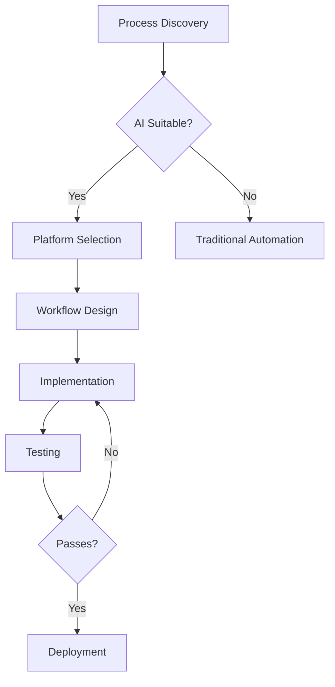

# Workflows

This directory contains detailed workflow definitions for the AI Automation Engineer skill.

## Structure

| File | Purpose |
|------|---------|
| `ai-automation-lifecycle.md` | Primary 10-step workflow for AI automation |
| `platform-selection.md` | Workflow for selecting orchestration platform |
| `cost-optimization.md` | Workflow for systematic cost reduction |
| `deployment.md` | Workflow for production deployment |
| `incident-response.md` | Workflow for handling automation failures |
| `diagrams/` | Mermaid/PlantUML workflow diagrams |

## Workflow Documentation Standard

Each workflow must document:

1. **Trigger** - What initiates this workflow
2. **Inputs** - Required and optional inputs
3. **Steps** - Sequential steps with decision points
4. **Outputs** - Expected deliverables
5. **Error Handling** - Failure modes and recovery
6. **Variations** - Alternative paths

## Diagram Format

Use Mermaid for diagrams:

## Integration with SKILL.md

The `workflow` section in SKILL.md provides the 10-step framework. This directory provides detailed implementation for each step.

## Testing

Workflows should have acceptance tests in `../tests/acceptance/`.