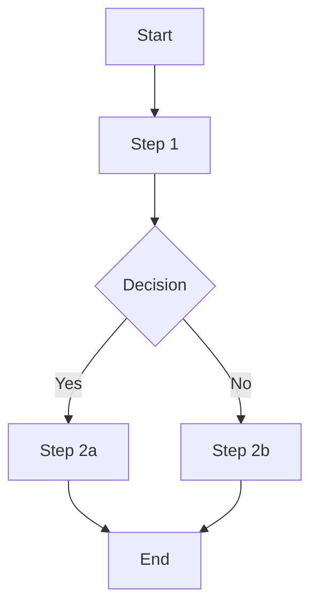

# Workflow Template

Version: 1.0.0
Use this template to document workflows for skills.

---

## Workflow: [Workflow Name]

### Metadata
- **Skill**: [skill-id]
- **Version**: [workflow version]
- **Trigger**: [What initiates this workflow]
- **Estimated Duration**: [time estimate]

### Inputs

| Input | Type | Required | Description |
|-------|------|----------|-------------|
| input1 | string | Yes | Description |
| input2 | object | No | Description |

### Steps

#### Step 1: [Step Name]
**Description**: What this step accomplishes

**Actions**:
1. Action 1
2. Action 2

**Decision Points**:
- If [condition] → [action]
- Else → [alternative]

**Outputs**: What this step produces

**Validation**: How to verify step completed correctly

---

#### Step 2: [Step Name]
**Description**: ...

**Actions**:
1. ...

**Outputs**: ...

**Validation**: ...

---

### Error Handling

| Failure Mode | Detection | Recovery |
|--------------|-----------|----------|
| [Failure] | [How detected] | [Recovery steps] |

### Outputs

| Output | Type | Description |
|--------|------|-------------|
| output1 | markdown | Description |

### Variations

- **Variation A**: When [condition], use [alternative steps]
- **Variation B**: When [condition], use [alternative steps]

### Diagram

### Testing

- Unit tests: `tests/unit/test_workflow_[name].py`
- Integration tests: `tests/integration/test_workflow_[name].py`
- Acceptance criteria: [reference to acceptance criteria]

---

*Delete this template section and replace with actual workflow documentation.*